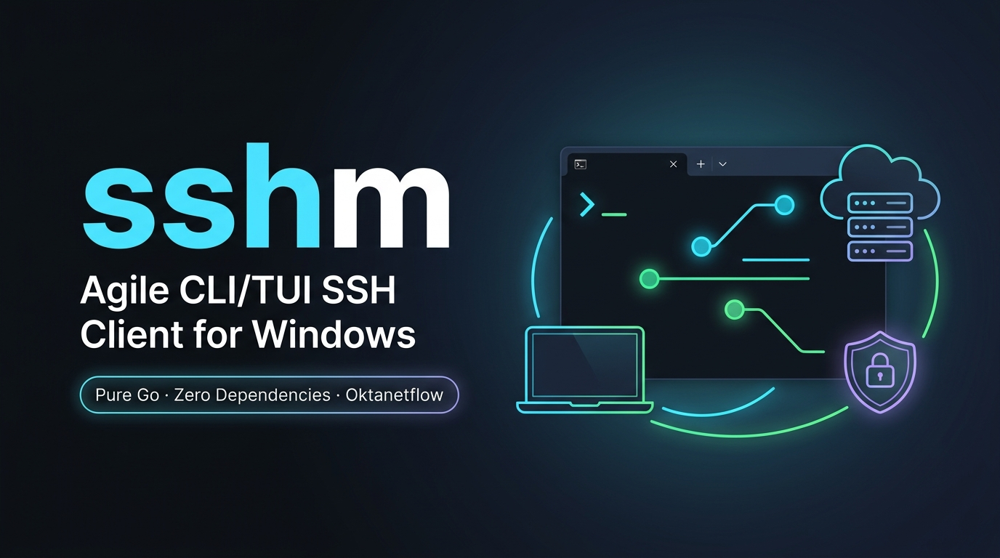
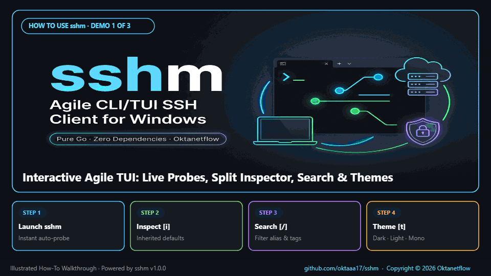
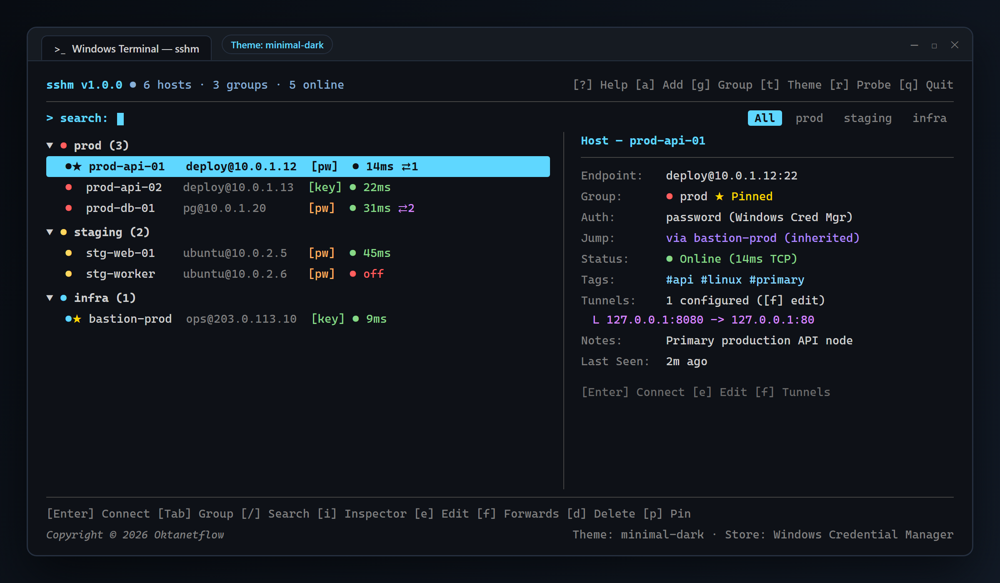
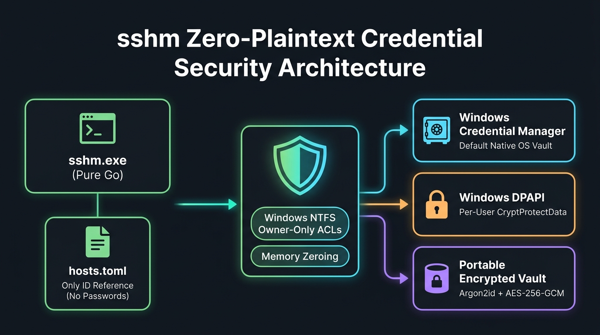

<p align="center">
  
</p>

# sshm — Agile CLI/TUI SSH Client for Windows

> **Publisher:** **Oktanetflow**  
> **Copyright:** `Copyright © 2026 Oktanetflow`  
> **License:** MIT  
> **Zero External Dependencies:** Pure Go (`CGO_ENABLED=0`) — no PuTTY, WSL, Cygwin, OpenSSH binary, or `sshpass` required.

`sshm` is a fast, single-binary SSH client and server manager engineered from the ground up for **Windows 10/11** (Windows Terminal, PowerShell 5.1/7+, CMD, VS Code) with cross-platform Linux/macOS support.

> **Independent Codebase Notice:** `sshm` by Oktanetflow is a completely original pure-Go SSH client & TUI implementation (not a clone or fork of `gu1llaum-3/sshm`). See [docs/ARCHITECTURE.md](docs/ARCHITECTURE.md) and [ADR-006](docs/decisions/ADR-006-independent-codebase-and-distribution.md) for a full technical breakdown.

---

## Illustrated How-To Walkthrough



Watch all 3 illustrated how-to videos (`.gif` + `.webm`) covering TUI navigation, Windows Credential Manager password saving, port forwarding (`-L`/`-R`/`-D`), parallel `@group` execution, and SFTP copy in **[docs/VIDEOS.md](docs/VIDEOS.md)**.

---

## Highlights

- **Agile Interactive TUI (`sshm`):**
  - **Split-Pane Host Inspector (`i`):** Inspect effective user/port, inherited group defaults, auth backend, jump chain, live TCP status, tags, tunnels, notes, and last-seen time side-by-side.
  - **Live Async TCP Reachability & Latency (`r`):** Non-blocking background probes show `● 14ms` / `● off` per host plus header online counters.
  - **Interactive Port Forward Manager (`f`):** View, add, and remove local (`-L`), remote (`-R`), and SOCKS5 (`-D`) tunnels per host right inside the TUI.
  - **Inline Tags, Notes & Quick Theme Switcher (`t`):** Cycle `minimal-dark`, `minimal-light`, and `mono` live with instant persistence.
  - **Collapsible Server Groups & Fuzzy Search (`/`):** Organize hosts into color-coded groups (`prod`, `staging`, `personal`) with inheritable `default_user`, `default_port`, `default_key`, and `default_jump`.
- **Save Password by Default — Zero Plaintext on Disk:**
  - Enabled out of the box (`save_password_by_default = true`).
  - Backed natively by **Windows Credential Manager (`CredWriteW`/`CredReadW`)**, **Windows DPAPI (`CryptProtectData`)**, or a portable **Argon2id + AES-256-GCM** encrypted vault.
  - Enforces **Windows owner-only NTFS DACLs** on `%APPDATA%\sshm\` and zeroes sensitive memory buffers immediately after use.
- **Native Windows Terminal & Power Features:**
  - Direct Win32 VT100 console processing (`ENABLE_VIRTUAL_TERMINAL_PROCESSING`), raw input passthrough, live window resize tracking, and native Windows OpenSSH agent (`\\.\pipe\openssh-ssh-agent`).
  - Built-in `ProxyJump` chaining, IPv4/IPv6 `-L/-R/-D` forwarding, SFTP file copy (`sshm cp`), parallel `@group` batch execution (`sshm exec @prod "uptime" --parallel`), `~/.ssh/config` & PuTTY Registry importers, encrypted `.sshm.enc` backups, and PowerShell tab completion.
- **Windows Security Friendly (No Need to Turn Off Defender):**
  - Embedded Win32 PE publisher metadata (`Oktanetflow`), `asInvoker` manifest (no UAC admin elevation), reproducible `-trimpath` builds, **no UPX packing**, SHA-256 checksums, GitHub Artifact Attestations, and ready-to-enable Authenticode / Microsoft Trusted Signing. See [SECURITY.md](SECURITY.md) & [docs/WINDOWS_PUBLISHER_GUIDE.md](docs/WINDOWS_PUBLISHER_GUIDE.md).

---

## Visual Mockups & Architecture

| Agile Split-Pane TUI (`minimal-dark`) | Zero-Plaintext Credential Security |
| :---: | :---: |
|  |  |

Browse all 6 high-DPI mockups (`minimal-dark`, `minimal-light`, `mono`, Add Host, Port Forwards, Group Inspector) in **[docs/MOCKUPS.md](docs/MOCKUPS.md)**.

---

## Installation (Windows)

### Option 1: Per-User Windows EXE Installer (Recommended)
1. Download `sshm-setup-1.0.0-amd64.exe` and `SHA256SUMS.txt` from [GitHub Releases](https://github.com/oktaaa17/sshm/releases).
2. Verify checksum in PowerShell:
   ```powershell
   Get-FileHash .\sshm-setup-1.0.0-amd64.exe -Algorithm SHA256
   ```
3. Run the installer — installs per-user into `%LOCALAPPDATA%\Programs\Oktanetflow\sshm` (no UAC admin prompt needed), adds `sshm` to your User `PATH`, and registers a clean uninstaller.

### Option 2: Standalone Portable Binary
Download `sshm-1.0.0-windows-amd64.exe` (or `arm64`), rename to `sshm.exe`, and place in any folder on your `PATH`.

### Option 3: Build from Source
```powershell
git clone https://github.com/oktaaa17/sshm.git
cd sshm
powershell -ExecutionPolicy Bypass -File scripts/build-release.ps1 -Version 1.0.0
```

---

## Quick Start

```powershell
# Launch interactive Agile TUI
sshm

# Add a host (masked password saved automatically to Windows Credential Manager)
sshm add prod-api --host 10.0.1.12 --user root --group prod --tags api,linux

# Create a group with inheritable defaults
sshm group create prod --color red --default-user root --default-port 22

# Connect directly by alias or ad-hoc user@host (supports IPv4 & [IPv6])
sshm prod-api
sshm ubuntu@[2001:db8::1]:2222

# Port forwarding (-L local, -R remote, -D dynamic SOCKS5)
sshm prod-db -L 5432:127.0.0.1:5432
sshm prod-api -D 1080

# Batch execute across a group in parallel
sshm exec @prod "uptime" --parallel

# Copy files over SFTP
sshm cp .\app.zip prod-api:/opt/app/

# Import existing hosts from OpenSSH config or PuTTY Registry
sshm import --ssh-config
sshm import --putty

# Enable PowerShell tab completion
sshm completion powershell | Out-String | Invoke-Expression
```

---

## Documentation Suite

| Resource | Description |
| :--- | :--- |
| [docs/README.md](docs/README.md) | **Documentation Hub** — Central index & visual illustrations gallery |
| [docs/VIDEOS.md](docs/VIDEOS.md) | **Illustrated How-To Demo Videos** — 3 guided workflows (`.gif` + `.webm`) |
| [docs/MOCKUPS.md](docs/MOCKUPS.md) | **Visual TUI Mockups** — High-DPI screens for all 3 themes & modals |
| [docs/USE_CASES.md](docs/USE_CASES.md) | **Real-World Use Cases** — 6 end-to-end playbooks (Bastion, DB tunnels, Fleet Ops, PuTTY migration, Portable Vault) |
| [docs/GUIDELINES.md](docs/GUIDELINES.md) | **Operational & Security Guidelines** — Backend matrix, naming, Defender trust & contributor standards |
| [docs/USAGE.md](docs/USAGE.md) | **Complete User Guide** — Every TUI keybinding, CLI command & config setting |
| [docs/ARCHITECTURE.md](docs/ARCHITECTURE.md) | **Architecture & Tech Stack** — Package map, diagrams & comparison vs `gu1llaum-3/sshm` |
| [docs/decisions/README.md](docs/decisions/README.md) | **Architecture Decision Records (ADRs)** — `ADR-001` through `ADR-006` explaining *why* |
| [docs/WINDOWS_PUBLISHER_GUIDE.md](docs/WINDOWS_PUBLISHER_GUIDE.md) | **Windows Publisher & SmartScreen Guide** — Authenticode, Trusted Signing & WDSI |
| [SECURITY.md](SECURITY.md) | **Security Policy** — Threat model, verification & responsible disclosure |
| [SPEC.md](SPEC.md) & [docs/SPEC_DOCUMENTATION.md](docs/SPEC_DOCUMENTATION.md) | **Living Specifications** — Product & documentation specs |
| [CLAUDE.md](CLAUDE.md) & [CONTRIBUTING.md](CONTRIBUTING.md) | **Contributor & Agent Guide** — Build commands, invariants & PR workflow |
| [CHANGELOG.md](CHANGELOG.md) | **Changelog** — Version history |

---

**Copyright © 2026 Oktanetflow.** Licensed under the [MIT License](LICENSE).
