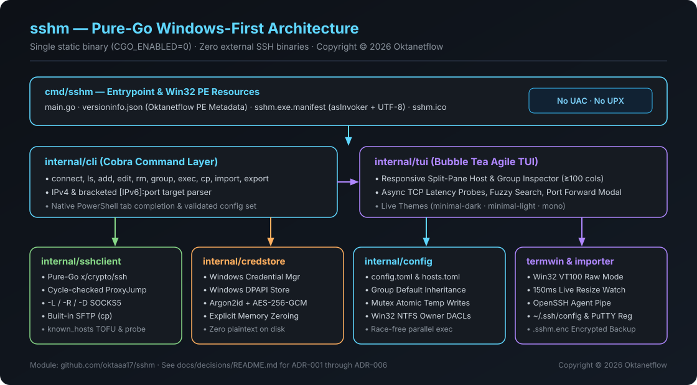
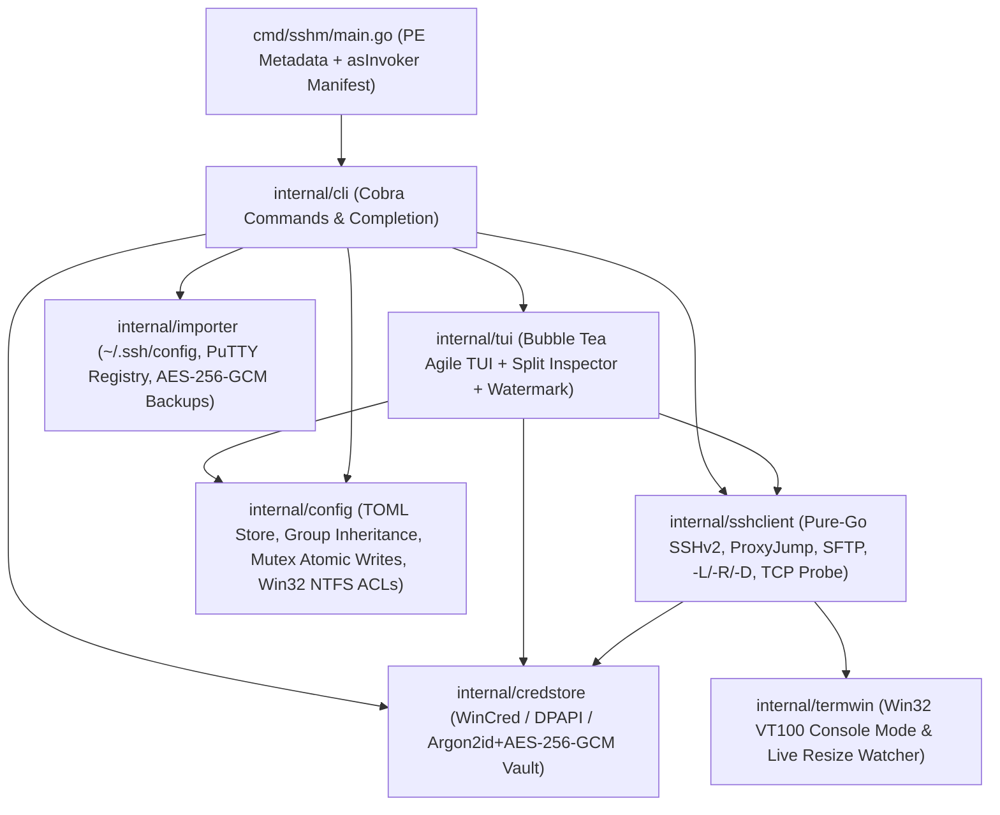
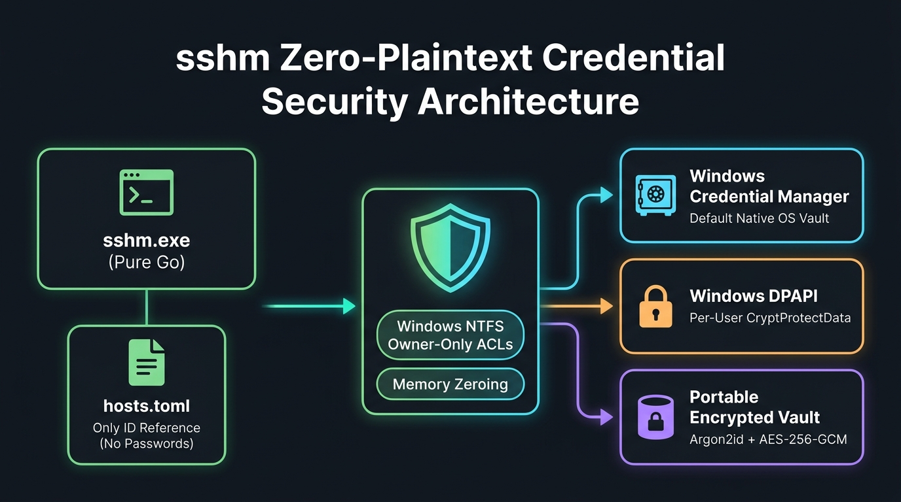
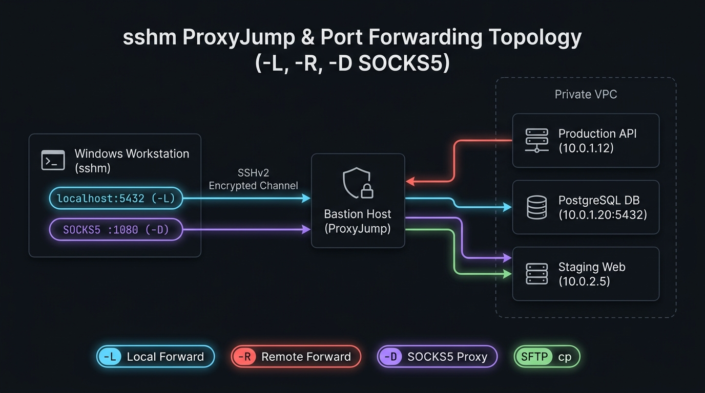

# Architecture & Tech Stack — sshm by Oktanetflow

> **Copyright © 2026 Oktanetflow**

## 1. Architectural Overview

`sshm` is a pure-Go (`CGO_ENABLED=0`), single-binary CLI & TUI SSH client designed with Windows 10/11 as a first-class platform. Unlike wrapper tools that shell out to `ssh.exe`, `sshm` embeds a complete native SSHv2 and SFTP protocol stack, native Win32 VT100 terminal management, and OS-native credential vaults.

---

## 2. Package Responsibilities

| Package | Responsibility | Key ADR |
| :--- | :--- | :--- |
| `cmd/sshm` | Binary entry point, `go:generate` Win32 PE resource embedding (`versioninfo.json`, `sshm.exe.manifest`, `assets/sshm.ico`). | [ADR-003](decisions/ADR-003-windows-first-vt100-ntfs-acl-and-pe-packaging.md) |
| `internal/cli` | Cobra subcommands (`connect`, `ls`, `add`, `edit`, `rm`, `group`, `exec`, `cp`, `import`, `export`, `hostkey`, `config`), IPv4/IPv6 ad-hoc target parser, PowerShell completion. | [ADR-001](decisions/ADR-001-pure-go-ssh-engine.md) |
| `internal/tui` | Bubble Tea Elm-architecture TUI (`model.go`, `inspector.go`, `forwards.go`, `styles.go`): collapsible groups, fuzzy search, split-pane inspector, async TCP latency probes, port-forward manager, theme switcher, and Oktanetflow watermark. | [ADR-004](decisions/ADR-004-bubble-tea-split-pane-tui-and-async-probing.md) |
| `internal/config` | Thread-safe TOML config/host manager, group-default inheritance, unique-temp atomic persistence, and Windows NTFS owner-only DACL hardening (`acl_windows.go`). | [ADR-005](decisions/ADR-005-toml-config-group-inheritance-and-atomic-writes.md) |
| `internal/credstore` | Pluggable `Store` interface with 3 backends: Windows Credential Manager (`advapi32.dll`), Windows DPAPI (`crypt32.dll`), and portable `Argon2id` + `AES-256-GCM` vault. | [ADR-002](decisions/ADR-002-save-password-by-default-and-credstore.md) |
| `internal/sshclient` | Pure-Go `golang.org/x/crypto/ssh` client, `ProxyJump` cycle-checked chaining, OpenSSH `known_hosts` TOFU/mismatch protection, keep-alive, SFTP copy, RFC 1928 SOCKS5 + `-L/-R` tunneling, and bounded TCP prober (`probe.go`). | [ADR-001](decisions/ADR-001-pure-go-ssh-engine.md) |
| `internal/termwin` | Native Win32 Console VT100 processing (`ENABLE_VIRTUAL_TERMINAL_PROCESSING` / `ENABLE_VIRTUAL_TERMINAL_INPUT`), raw mode restoration, and 150ms resize polling. | [ADR-003](decisions/ADR-003-windows-first-vt100-ntfs-acl-and-pe-packaging.md) |
| `internal/importer` | OpenSSH `~/.ssh/config` parser, Windows PuTTY Registry (`HKCU\Software\SimonTatham\PuTTY\Sessions`) importer, and encrypted `.sshm.enc` export/import. | [ADR-005](decisions/ADR-005-toml-config-group-inheritance-and-atomic-writes.md) |

---

## 3. Security & Network Topology Visuals

---

## 4. Architecture Decision Records (ADRs)

Read the full rationale and rejected alternatives behind every core technical choice in [docs/decisions/README.md](decisions/README.md):
- [ADR-001: Pure-Go Embedded SSHv2 & SFTP Engine](decisions/ADR-001-pure-go-ssh-engine.md)
- [ADR-002: Save-Password-by-Default with Three-Tier Credential Store](decisions/ADR-002-save-password-by-default-and-credstore.md)
- [ADR-003: Native Win32 VT100 PTY, NTFS Owner-Only ACLs & Non-Packed PE Packaging](decisions/ADR-003-windows-first-vt100-ntfs-acl-and-pe-packaging.md)
- [ADR-004: Bubble Tea Split-Pane Agile TUI & Bounded Async TCP Probing](decisions/ADR-004-bubble-tea-split-pane-tui-and-async-probing.md)
- [ADR-005: TOML Configuration, Group Default Inheritance & Mutex-Safe Atomic Persistence](decisions/ADR-005-toml-config-group-inheritance-and-atomic-writes.md)
- [ADR-006: Independent Codebase & Per-User Windows Inno Setup Distribution](decisions/ADR-006-independent-codebase-and-distribution.md)

---

## 5. Comparison vs `github.com/gu1llaum-3/sshm`

`sshm` by Oktanetflow is **not a clone or fork** of `gu1llaum-3/sshm` (see [ADR-006](decisions/ADR-006-independent-codebase-and-distribution.md)). It is a ground-up independent Go codebase tailored for Windows-first operations:

| Capability | Oktanetflow `sshm` | `gu1llaum-3/sshm` |
| :--- | :--- | :--- |
| **SSH Engine** | Built-in pure-Go `x/crypto/ssh` + SFTP + Win32 VT100 PTY | Executes external system `ssh` binary |
| **Config Store** | `%APPDATA%\sshm\config.toml` & `hosts.toml` + group defaults + importers | Native `~/.ssh/config` (`Include`) directly |
| **Password Security** | Save-password-by-default via Windows Credential Manager / DPAPI / AES-256-GCM vault + Win32 NTFS ACLs | Delegates to system OpenSSH keys/agent |
| **Batch & File Ops** | Parallel `@group` `exec` + built-in SFTP `cp` + encrypted backups | Focused on interactive SSH + port forwarding |
| **Windows Packaging** | Win32 PE metadata, `asInvoker` manifest, per-user Inno Setup `.exe` installer | Cross-platform binary |
