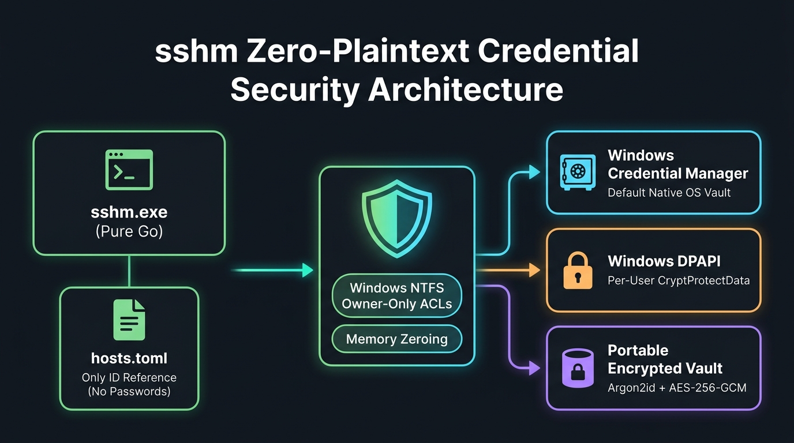
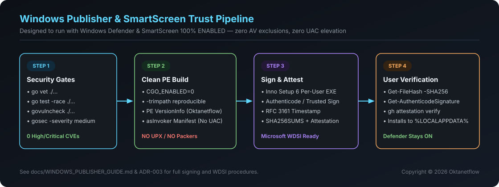

# Operational, Security & Contribution Guidelines — sshm by Oktanetflow

> **Publisher:** Oktanetflow · **Copyright © 2026 Oktanetflow**  
> **Scope:** Daily Windows Operations · Credential Hygiene · Team Workflows · Windows Security Compliance · Code & ADR Standards

---

## 1. Credential Backend Selection Guideline

`sshm` never stores plaintext passwords in `hosts.toml` (see [ADR-002](decisions/ADR-002-save-password-by-default-and-credstore.md)). Choose the credential backend that matches your workstation environment:



| Environment | Recommended Backend | Command to Set | Why |
| :--- | :--- | :--- | :--- |
| **Standard Windows 10/11 Workstation** *(Default)* | `wincred` | `sshm config set credential_backend wincred` | Uses native Windows Credential Manager (`CredWriteW`/`CredReadW`), integrated with your Windows login session. |
| **Headless / Restricted Windows Session / Automation** | `dpapi` | `sshm config set credential_backend dpapi` | Uses per-user `CryptProtectData` bound to your Windows SID with atomic file storage and explicit memory zeroing. |
| **Portable USB / Shared Config / Cross-Platform (Win + Linux + macOS)** | `vault` | `sshm config set credential_backend vault` | Self-contained `vault.enc` encrypted with **Argon2id + AES-256-GCM**; prompts once for a master passphrase. |

### Credential Hygiene Rules
- **Prefer SSH keys + Windows OpenSSH Agent** (`\\.\pipe\openssh-ssh-agent`) for long-lived production hosts; keep `save_password_by_default = true` for appliances, lab VMs, and mixed environments.
- **Avoid shell history exposure:** Never embed passwords in scripts or command arguments. Use interactive masked prompts or `--password-stdin`:
  ```powershell
  Get-Content .\secret.txt | sshm add lab-box --host 10.0.5.10 --user admin --password-stdin
  ```
- **Disable saving for ephemeral/shared hosts:** Pass `--no-save-password` (CLI) or toggle **Save Password: [ ]** inside the TUI Add/Edit modal (`a` / `e`).
- **Rotate compromised credentials cleanly:** Run `sshm edit <alias> --update-password` to overwrite the secret in place without orphaning `credential_ref`.
- **Clean decommissioning:** Use `sshm rm <alias>` or `sshm group rm <name> --delete-hosts` so both stored host passwords and key passphrases are purged from the active credential store.

---

## 2. Host Grouping & Naming Conventions

Well-structured groups turn `sshm` into an instant operational dashboard and prevent accidental production commands:

| Group | Recommended Badge Color | Suggested Defaults |
| :--- | :--- | :--- |
| `prod` | `red` | `--default-user deploy --default-jump bastion-prod --default-key ~/.ssh/id_ed25519_prod` |
| `staging` | `yellow` | `--default-user ubuntu --default-jump bastion-stg` |
| `dev` / `lab` | `green` | `--default-user dev --default-port 22` |
| `network` / `infra` | `cyan` | `--default-port 2222` |
| `personal` | `blue` | Personal keys & home lab hosts |

### Best Practices
- **Use semantic aliases:** `<env>-<service>-<nn>` (e.g., `prod-api-01`, `prod-db-01`, `stg-web-02`) so fuzzy search (`/`) and tab completion stay instant.
- **Put shared fields on the Group, not every Host:** Set `default_user`, `default_port`, `default_key`, and `default_jump` at the group level so changing a bastion or key updates every member automatically ([ADR-005](decisions/ADR-005-toml-config-group-inheritance-and-atomic-writes.md)).
- **Pin critical hosts (`p`):** Pin bastions and primary API/DB nodes so they stay fixed at the top of each group.
- **Tag for cross-cutting queries:** Add tags (`--tags api,linux,pci`) and concise notes (`Primary checkout API`) — both are searchable via `/` and visible in the Split-Pane Inspector (`i`).

---

## 3. Network, Tunneling & Host Key Safety Guidelines

- **Keep Strict Host Key Checking enabled (`ask` or `yes`):**
  ```powershell
  sshm config set strict_host_key_checking ask
  ```
  Never set `no` globally on production workstations. When a server is legitimately rebuilt and its fingerprint changes, verify the new key out-of-band, then clear the stale entry:
  ```powershell
  sshm hostkey remove prod-api-01
  ```
- **Bind port forwards to loopback (`127.0.0.1` or `[::1]`) by default:**
  - Safe: `sshm prod-db -L 127.0.0.1:5432:127.0.0.1:5432` and `sshm prod-api -D 127.0.0.1:1080`
  - Caution: Binding `-D 0.0.0.0:1080` exposes an unauthenticated SOCKS5 proxy to your LAN (`sshm` emits a loud security warning whenever a non-loopback bind is requested).
- **Strict firewall / IDS environments:** If background TCP reachability probing on launch triggers IDS alerts, disable auto-probing and probe manually with `r` only when needed:
  ```powershell
  sshm config set auto_probe_on_start false
  ```
- **Keepalives for NAT / VPN drops:** Configure periodic keepalives (default `30s`) so idle tunnels stay healthy across corporate VPNs:
  ```powershell
  sshm config set keepalive_interval_sec 30
  ```

---

## 4. Windows Defender, SmartScreen & Enterprise Deployment Guidelines



> **Golden Rule:** Never disable Windows Defender, Windows Security, or SmartScreen to install or run `sshm`.

1. **Prefer the Per-User Installer (`sshm-setup-<version>-amd64.exe`):** Installs into `%LOCALAPPDATA%\Programs\Oktanetflow\sshm` without requiring local Administrator (UAC) rights.
2. **Verify every release before running:**
   ```powershell
   # 1. Verify SHA-256 against SHA256SUMS.txt
   Get-FileHash .\sshm-setup-1.0.0-amd64.exe -Algorithm SHA256

   # 2. Verify Oktanetflow PE metadata
   (Get-Item .\sshm.exe).VersionInfo | Format-List CompanyName, ProductName, ProductVersion, LegalCopyright

   # 3. Verify Authenticode signature (signed releases)
   Get-AuthenticodeSignature .\sshm.exe | Format-List Status, SignerCertificate
   ```
3. **Verify NTFS ACL hardening on `%APPDATA%\sshm\`:** `sshm` automatically applies owner-only DACLs (current user SID + `NT AUTHORITY\SYSTEM`). Inspect anytime with:
   ```powershell
   icacls "$env:APPDATA\sshm"
   ```
4. **Release Maintainers:** Follow [WINDOWS_PUBLISHER_GUIDE.md](WINDOWS_PUBLISHER_GUIDE.md) for Authenticode / Microsoft Trusted Signing and Microsoft WDSI submission. Never pack binaries with UPX ([ADR-003](decisions/ADR-003-windows-first-vt100-ntfs-acl-and-pe-packaging.md)).

---

## 5. Backup, Migration & Team Sharing Guidelines

- **Encrypted Full Backups (Workstation Recovery):**
  ```powershell
  sshm export .\oktanetflow-workstation.sshm.enc
  ```
  Uses **Argon2id + AES-256-GCM** encryption. Store `.sshm.enc` in a secure password manager or private encrypted vault — **never commit `.sshm.enc` to Git** (blocked in `.gitignore`).
- **Sharing Host Inventory with Teammates (No Personal Passwords):**
  ```powershell
  sshm export .\team-inventory.sshm.enc --with-passwords=false
  ```
  Teammates import the topology and group defaults into their own `sshm` instance without sharing personal credentials:
  ```powershell
  sshm import --backup .\team-inventory.sshm.enc
  ```

---

## 6. Contributor, Code & Documentation Guidelines

Following `/spec-driven-development` and `/documentation-and-adrs`:

### Before Writing Code
1. **Spec first:** For any multi-file feature or behavioral change, update [SPEC.md](../SPEC.md) (or create a scoped spec in `docs/`) before writing code.
2. **Check existing ADRs:** Read [docs/decisions/README.md](decisions/README.md) so you respect past decisions and constraints.
3. **Write a new ADR** whenever you introduce a major dependency, change storage/crypto formats, alter Windows packaging, or reverse a previous decision. Never delete old ADRs; supersede them.

### Coding & Security Invariants
- Keep builds **100% pure Go (`CGO_ENABLED=0`)** and `-trimpath` reproducible.
- Wrap errors with `%w`, format with `gofmt`, and comment *why* (non-obvious invariants/gotchas) rather than *what*.
- Run all quality and security gates before opening a PR:
  ```powershell
  powershell -ExecutionPolicy Bypass -File scripts/security-scan.ps1
  ```

### Documentation & Visual Asset Maintenance
- Whenever TUI layouts, colors (`internal/tui/styles.go`), or CLI commands (`internal/cli/root.go`) change:
  1. Update `docs/USAGE.md`, `docs/USE_CASES.md`, and relevant ADRs.
  2. Regenerate mockups and illustrated demo videos:
     ```powershell
     node docs/scripts/render-media.mjs
     ```
  3. Validate all links, ADR sections, and binary media headers:
     ```powershell
     powershell -ExecutionPolicy Bypass -File docs/scripts/verify-docs.ps1
     ```
