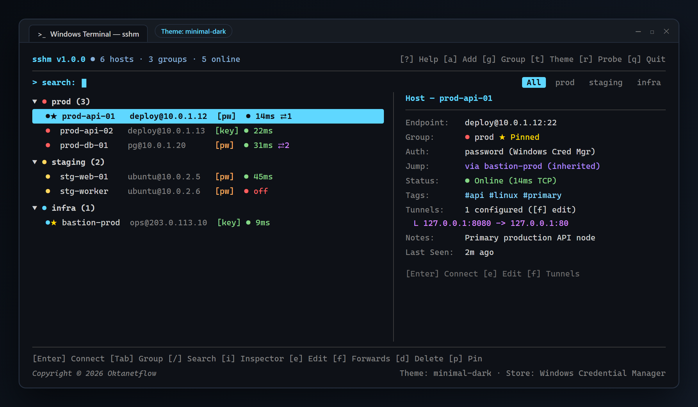
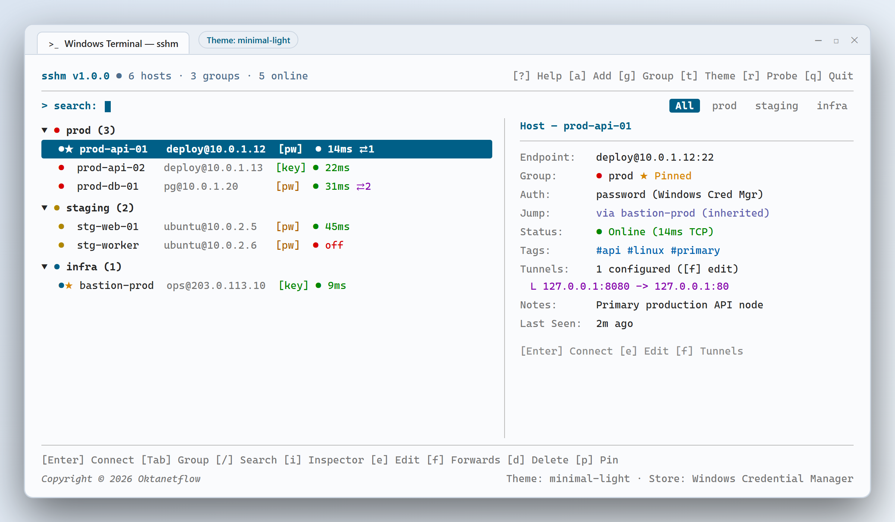
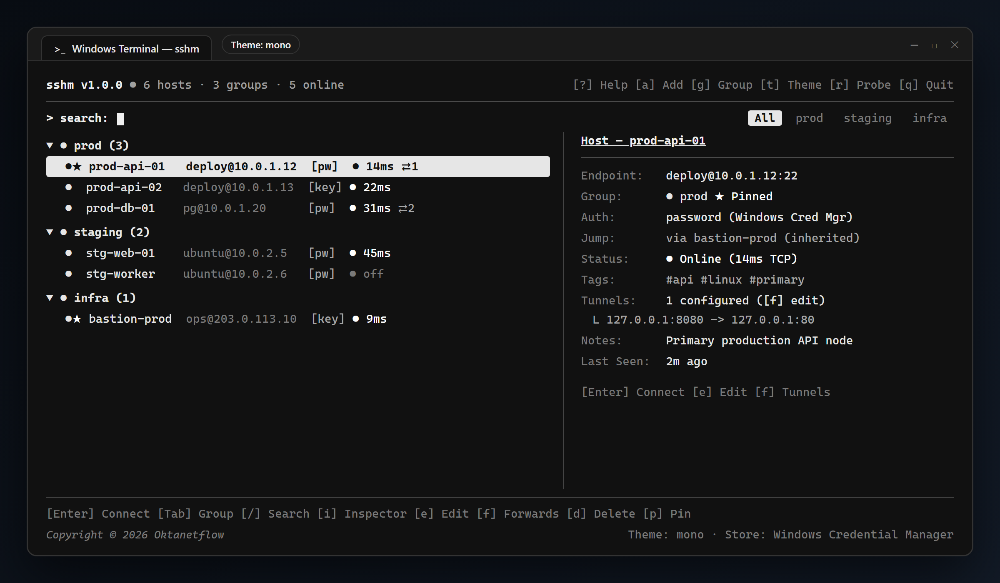
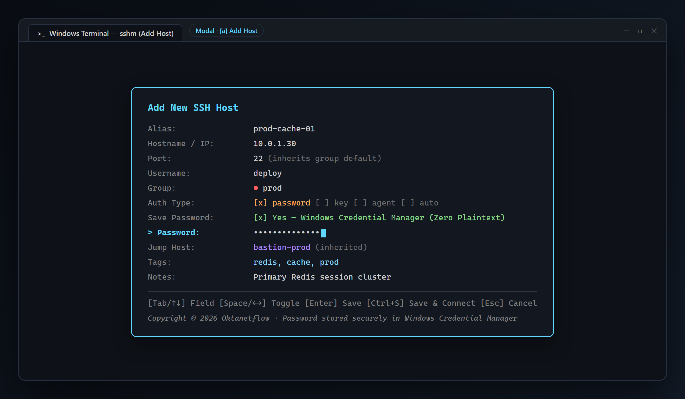
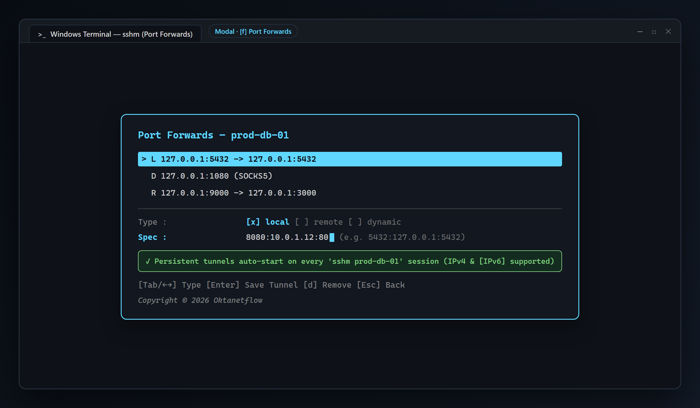
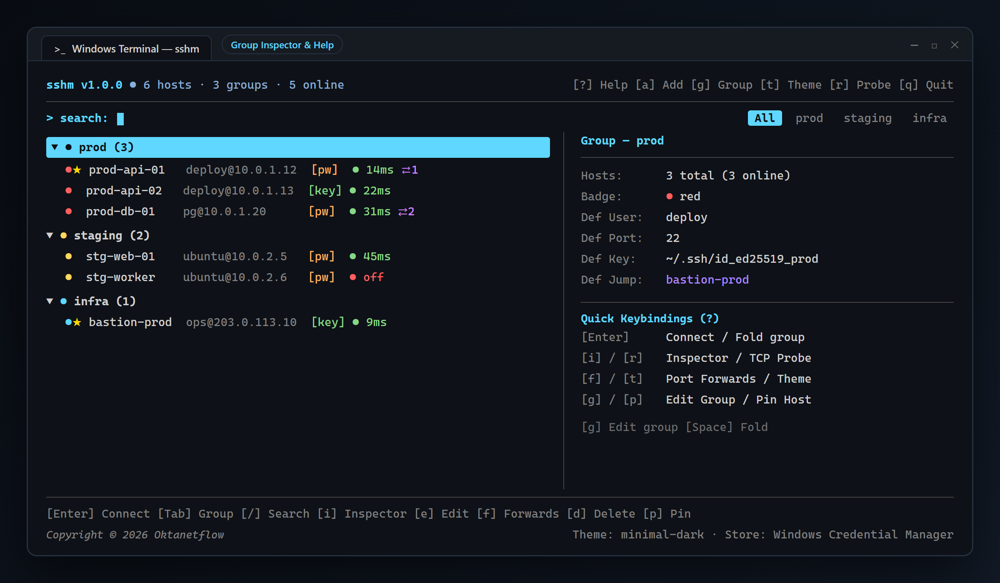

# Visual TUI Mockups & Theme Gallery — sshm by Oktanetflow

> **Publisher:** Oktanetflow · **Copyright © 2026 Oktanetflow**  
> **Source Palette:** Exact xterm-256 styles from [`internal/tui/styles.go`](../internal/tui/styles.go) · **Regenerate:** `node docs/scripts/render-media.mjs`

This gallery showcases every interactive screen, modal, and built-in theme of `sshm`'s Bubble Tea Agile TUI.

---

## 1. Main Dashboard — Split-Pane Host Inspector (`minimal-dark`, Default)

Auto-enabled on terminals ≥ 100 columns wide (toggle anytime with `i`). Displays collapsible color-coded groups, live async TCP latency badges (`● 14ms` / `● off`), auth badges (`[pw]` / `[key]`), tunnel counts (`⇄1`), pinned stars (`★`), and the live **Host Inspector** on the right.

---

## 2. Built-In Themes (Cycle Live with `t`)

Press **`t`** at any time inside `sshm` to cycle `minimal-dark` → `minimal-light` → `mono` with instant persistence to `%APPDATA%\sshm\config.toml`.

### `minimal-light` (Daylight / Light Windows Terminal)

### `mono` (High-Contrast / Monochrome Accessible Mode)

---

## 3. Add / Edit Host Modal (`a` / `e`)

**Save Password** is enabled by default (`[x] Yes — Windows Credential Manager`) with masked password entry and inline **Tags** & **Notes**. Editing an existing host preserves `Pinned`, `LastConnected`, `Forwards`, and `CredentialRef` (see [ADR-002](decisions/ADR-002-save-password-by-default-and-credstore.md)).

---

## 4. Interactive Port Forward Manager (`f`)

View, add, and remove persistent local (`-L`), remote (`-R`), and dynamic SOCKS5 (`-D`) tunnels per host directly inside the TUI. Configured tunnels auto-start whenever you connect to that host.

---

## 5. Group Inspector & Quick Keybindings (`g` / `?`)

Highlighting any group header switches the right Split-Pane Inspector into **Group Inspector** mode, showing live online counts (`3 total (3 online)`), badge color, and all inheritable group defaults (`default_user`, `default_port`, `default_key`, `default_jump`).

---

## See Also
- [Illustrated How-To Demo Videos](VIDEOS.md) — Watch animated step-by-step walkthroughs of every workflow
- [Complete User Guide](USAGE.md) — Full TUI shortcut table and CLI command reference
- [ADR-004: Bubble Tea Split-Pane TUI & Async Probing](decisions/ADR-004-bubble-tea-split-pane-tui-and-async-probing.md)
