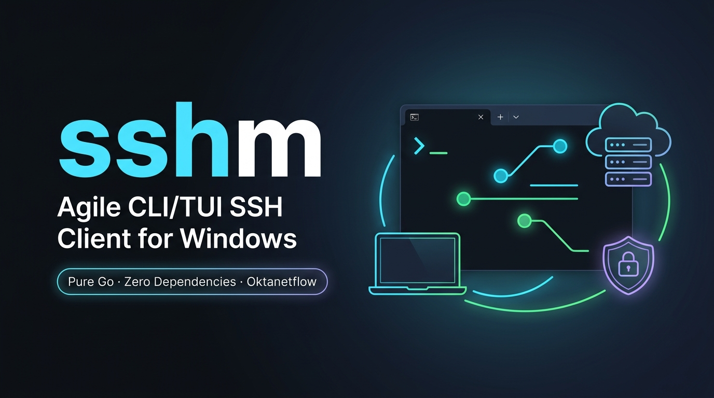
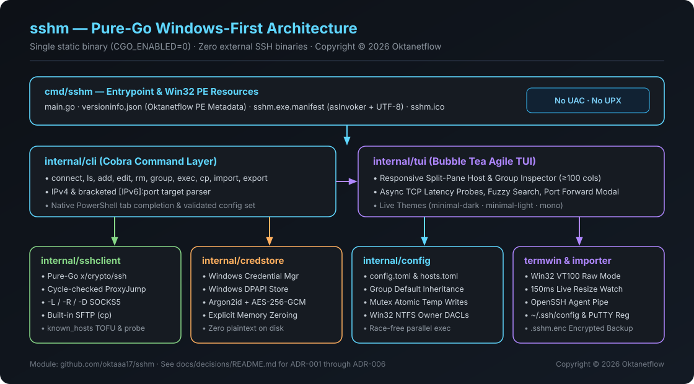
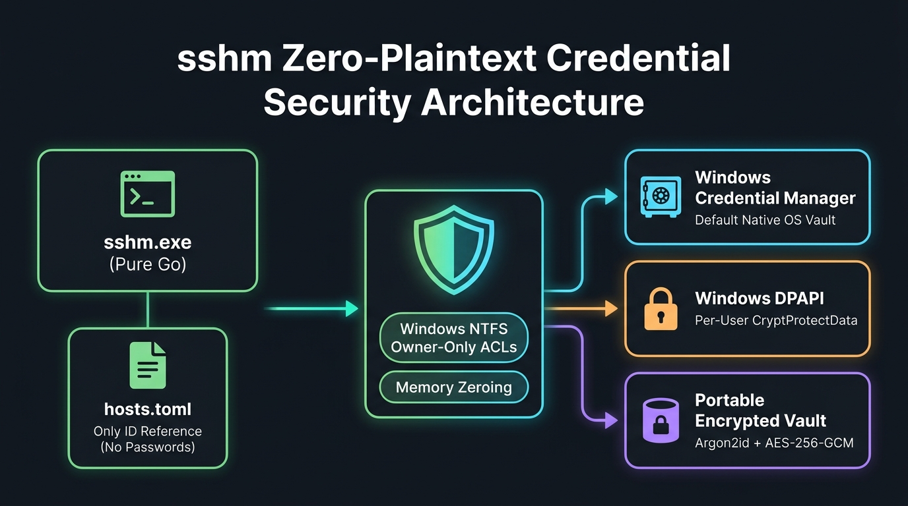
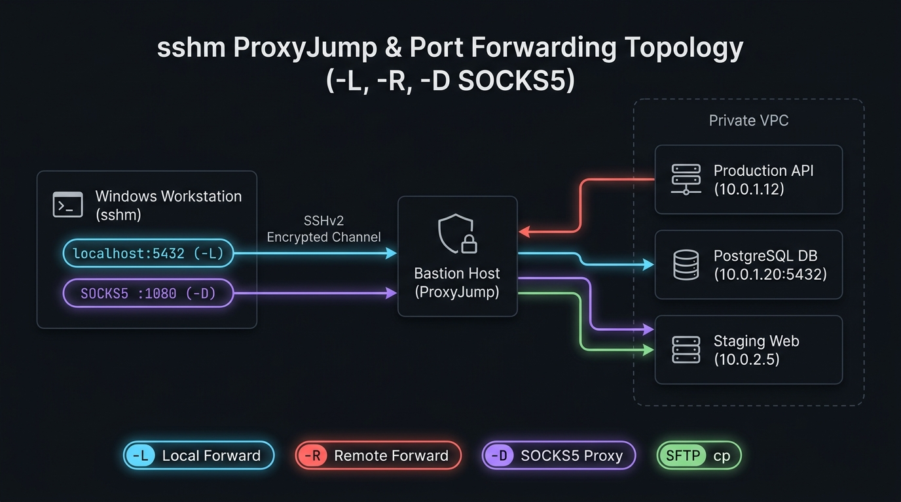
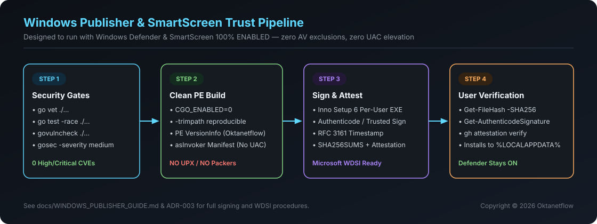

# sshm Documentation Hub — Oktanetflow

> **Publisher:** Oktanetflow · **Copyright © 2026 Oktanetflow** · **License:** MIT

Welcome to the official documentation hub for **`sshm`** — the pure-Go, zero-dependency, Windows-first CLI & TUI SSH client.

---

## Quick Navigation

| Section | Document | Best For |
| :--- | :--- | :--- |
| **Getting Started** | [README.md](../README.md) | Overview, Windows EXE installer, quick start commands |
| **User Manual** | [USAGE.md](USAGE.md) | Complete TUI keybindings, CLI commands, and config keys |
| **How-To Videos** | [VIDEOS.md](VIDEOS.md) | 3 illustrated step-by-step walkthroughs (`.gif` + `.webm`) |
| **Visual Mockups** | [MOCKUPS.md](MOCKUPS.md) | High-DPI gallery of all 3 themes (`minimal-dark`, `minimal-light`, `mono`) & modals |
| **Use Cases** | [USE_CASES.md](USE_CASES.md) | 6 real-world playbooks (Bastion `ProxyJump`, DB tunnels, `@group` parallel ops, PuTTY migration, portable vault) |
| **Guidelines** | [GUIDELINES.md](GUIDELINES.md) | Credential backend matrix, naming conventions, security hygiene, team sharing, contributor rules |
| **Architecture** | [ARCHITECTURE.md](ARCHITECTURE.md) | Package map, diagrams, and technical comparison vs `gu1llaum-3/sshm` |
| **ADRs** | [decisions/README.md](decisions/README.md) | `ADR-001` through `ADR-006` explaining *why* core engineering choices were made |
| **Windows Security** | [WINDOWS_PUBLISHER_GUIDE.md](WINDOWS_PUBLISHER_GUIDE.md) & [SECURITY.md](../SECURITY.md) | Authenticode / Microsoft Trusted Signing, SmartScreen, NTFS ACLs, WDSI submission |
| **Living Specs** | [SPEC.md](../SPEC.md) & [SPEC_DOCUMENTATION.md](SPEC_DOCUMENTATION.md) | Product & documentation specifications |
| **Agent Context** | [CLAUDE.md](../CLAUDE.md) | Concise commands, invariants, and gotchas for AI agents & contributors |

---

## Visual Illustrations Gallery

### System & Package Architecture

### Zero-Plaintext Credential Security Architecture

### ProxyJump & Port Forwarding Topology (`-L`, `-R`, `-D` SOCKS5)

### Windows Publisher & SmartScreen Trust Pipeline

