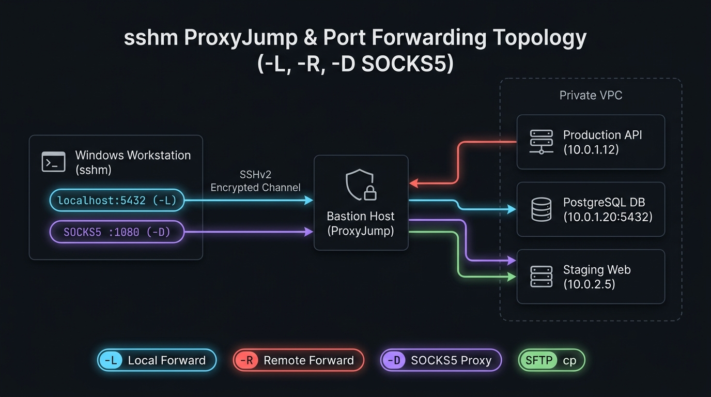

# Real-World Use Cases & Playbooks — sshm by Oktanetflow

> **Publisher:** Oktanetflow · **Copyright © 2026 Oktanetflow**

This guide walks through **six practical, end-to-end scenarios** showing how Windows developers, DevOps engineers, and sysadmins use `sshm` in daily work.

---

## Use Case Index

| # | Scenario | Key `sshm` Capabilities Used |
| :--- | :--- | :--- |
| [UC-1](#uc-1-solo-windows-developer--daily-interactive-tui-workflow) | Solo Windows Developer — Daily TUI Workflow | Agile TUI, Split-Pane Inspector (`i`), Fuzzy Search (`/`), Live TCP Probes (`r`), Theme Switch (`t`) |
| [UC-2](#uc-2-multi-environment-production-ops-via-bastion-proxyjump) | Multi-Environment Production Ops via Bastion | Group Inheritance (`default_jump`, `default_key`, `default_user`), `ProxyJump`, Pinned Hosts |
| [UC-3](#uc-3-secure-database-tunneling--internal-socks5-proxy) | Secure Database Tunneling & Internal SOCKS5 Proxy | Persistent TUI Forwards (`f`), `-L` Local Forward, `-R` Remote Forward, `-D` SOCKS5, IPv6 |
| [UC-4](#uc-4-fleet-health-checks--sftp-artifact-deployment) | Fleet Health Checks & SFTP Artifact Deployment | Parallel `sshm exec @group --parallel`, Mutex-Safe Writes, Built-in SFTP `sshm cp` |
| [UC-5](#uc-5-zero-friction-migration-from-putty--openssh-config) | Zero-Friction Migration from PuTTY & OpenSSH | `sshm import --putty`, `sshm import --ssh-config`, Windows Credential Manager |
| [UC-6](#uc-6-portable-air-gapped-vault--workstation-recovery) | Portable / Air-Gapped Vault & Workstation Recovery | `--config-dir`, Argon2id + AES-256-GCM `vault`, Encrypted `.sshm.enc` Export/Import |

---

## UC-1: Solo Windows Developer — Daily Interactive TUI Workflow

**Persona:** Full-stack engineer on Windows 11 using Windows Terminal & PowerShell 7 across 15+ dev, staging, and personal VPS servers.

**Problem:** Remembering IP addresses, non-standard ports, and passwords across projects slows down context switching; PuTTY feels clunky and external OpenSSH lacks an organized visual inventory.

### Step-by-Step Workflow
1. **Enable PowerShell tab completion** (one-time setup in `$PROFILE`):
   ```powershell
   Add-Content $PROFILE 'sshm completion powershell | Out-String | Invoke-Expression'
   ```
2. **Add your first host** (password is prompted masked and saved automatically to Windows Credential Manager):
   ```powershell
   sshm add dev-api --host 192.168.50.12 --user dev --group dev --tags api,node --pin
   ```
3. **Launch the Agile TUI:**
   ```powershell
   sshm
   ```
4. **Navigate like a pro:**
   - Check live green/red TCP latency badges (`● 14ms` / `● off`) populated automatically on startup (press `r` to re-probe).
   - Press `/` and type `api` to fuzzy-filter across alias, hostname, tags, and notes.
   - View full effective user, auth backend, tunnels, notes, and last-seen time in the **Split-Pane Host Inspector** (`i` toggles on/off).
   - Press `t` to switch between `minimal-dark`, `minimal-light` (daylight laptop work), and `mono`.
   - Press `Enter` to open a native Win32 VT100 SSH shell immediately.

> **Visual Walkthrough:** Watch [Demo 1 — Agile TUI Workflow](VIDEOS.md#demo-1-agile-tui-navigation-inspector-search-probes--themes) and browse [MOCKUPS.md](MOCKUPS.md).

---

## UC-2: Multi-Environment Production Ops via Bastion (`ProxyJump`)

**Persona:** SRE / DevOps Engineer managing private VPC servers (`10.0.1.x`) reachable only through a hardened bastion host.

**Problem:** Repeating `-J bastion-prod -i ~/.ssh/id_ed25519_prod -l deploy` on every server is error-prone and painful to update when keys or bastions rotate.



### Step-by-Step Workflow
1. **Register the bastion host** (pinned in a dedicated `infra` group):
   ```powershell
   sshm group create infra --color cyan
   sshm add bastion-prod --host 203.0.113.10 --port 2222 --user ops --group infra --key ~/.ssh/id_ed25519_prod --auth key --pin
   ```
2. **Create the `prod` group with inheritable defaults:**
   ```powershell
   sshm group create prod `
     --color red `
     --default-user deploy `
     --default-port 22 `
     --default-key ~/.ssh/id_ed25519_prod `
     --default-jump bastion-prod
   ```
3. **Add private VPC hosts cleanly** (they automatically inherit `deploy`, port `22`, key, and `via bastion-prod`):
   ```powershell
   sshm add prod-api-01 --host 10.0.1.12 --group prod --tags api,primary --pin
   sshm add prod-api-02 --host 10.0.1.13 --group prod --tags api
   sshm add prod-db-01  --host 10.0.1.20 --user pg --group prod --tags postgres,db
   ```
4. **Connect in one command** (`sshm` dials `bastion-prod` first with cycle detection, then tunnels natively to `10.0.1.12` using Windows OpenSSH Agent or your key):
   ```powershell
   sshm prod-api-01
   ```
5. **Inspect inherited configuration:** In the TUI, highlighting `prod-api-01` displays `Jump: via bastion-prod (inherited)` inside the Split-Pane Inspector.

---

## UC-3: Secure Database Tunneling & Internal SOCKS5 Proxy

**Persona:** Backend Engineer needing local DBeaver / pgAdmin access to a private PostgreSQL database and browser access to internal Prometheus/Grafana dashboards without exposing public ports.

### Option A: One-Off CLI Tunnels (Supports IPv4 & Bracketed IPv6)
```powershell
# Forward local 127.0.0.1:5432 -> remote private Postgres 10.0.1.20:5432 via prod-db-01
sshm prod-db-01 -L 127.0.0.1:5432:127.0.0.1:5432

# IPv6 loopback local forward
sshm prod-api-01 -L [::1]:8080:127.0.0.1:80

# Dynamic SOCKS5 proxy on 127.0.0.1:1080 (point browser/curl at socks5h://127.0.0.1:1080)
sshm prod-api-01 -D 127.0.0.1:1080

# Expose local dev webhook server (localhost:3000) to remote port 9000 (-R)
sshm stg-web -R 127.0.0.1:9000:127.0.0.1:3000
```

### Option B: Persistent Tunnels Managed Inside the TUI (`f`)
1. Launch `sshm`, highlight `prod-db-01`, and press **`f`** to open the **Port Forwards** modal.
2. Press **`a`**, cycle type (`local` / `remote` / `dynamic`) with `Tab`, type `5432:127.0.0.1:5432`, and press **`Enter`**.
3. The host row now shows the `⇄1` tunnel badge and lists active tunnels in the Split-Pane Inspector. Every future `sshm prod-db-01` connection automatically starts those tunnels!

> **Visual Walkthrough:** Watch [Demo 3 — Port Forwards, Parallel Batch Exec & SFTP](VIDEOS.md#demo-3-port-forwards-parallel-group-batch-exec--sftp-cp).

---

## UC-4: Fleet Health Checks & SFTP Artifact Deployment

**Persona:** Release Engineer deploying a build artifact and checking disk/service health across all production nodes from PowerShell.

### Step-by-Step Workflow
1. **Run a parallel read-only health check across the entire `@prod` group:**
   ```powershell
   sshm exec @prod "hostname && uptime && df -h /" --parallel
   ```
   `sshm` executes concurrently across all hosts in `prod`, prefixes each host's output cleanly, and updates `LastConnected` using mutex-protected atomic writes with zero file corruption ([ADR-005](decisions/ADR-005-toml-config-group-inheritance-and-atomic-writes.md)).
2. **Upload a release artifact over built-in SFTP (no `scp.exe` or WinSCP needed):**
   ```powershell
   sshm cp .\dist\release-v2.4.tar.gz prod-api-01:/opt/releases/
   ```
3. **Pull remote logs back to Windows for inspection:**
   ```powershell
   sshm cp prod-api-01:/var/log/app/error.log .\logs\prod-api-01-error.log
   ```
4. **Trigger a service restart and verify status:**
   ```powershell
   sshm exec prod-api-01 "sudo systemctl restart myapp && systemctl is-active myapp"
   ```

---

## UC-5: Zero-Friction Migration from PuTTY & OpenSSH Config

**Persona:** Windows Systems Administrator switching from 40 legacy PuTTY sessions and a `~/.ssh/config` file to `sshm`.

### Step-by-Step Workflow
1. **Import all saved PuTTY sessions directly from the Windows Registry** (`HKCU\Software\SimonTatham\PuTTY\Sessions`):
   ```powershell
   sshm import --putty --group legacy-putty
   ```
2. **Import existing OpenSSH hosts** (including `HostName`, `User`, `Port`, `IdentityFile`, and `ProxyJump`):
   ```powershell
   sshm import --ssh-config --group openssh-import
   ```
   *(Or specify a custom path with `--ssh-config-path C:\work\ssh_config`.)*
3. **Verify imported inventory in structured JSON or grouped table:**
   ```powershell
   sshm ls
   sshm ls --flat --json | ConvertFrom-Json | Format-Table Alias, Group, Hostname, EffectiveUser
   ```
4. **Launch `sshm` TUI**, organize hosts into `prod`/`staging`/`network`, and connect — on first password login, `sshm` automatically saves credentials into Windows Credential Manager (never plaintext).

---

## UC-6: Portable / Air-Gapped Vault & Workstation Recovery

**Persona:** Field Network Engineer carrying a portable `sshm.exe` on an encrypted USB drive or migrating to a freshly imaged Windows 11 laptop.

### Scenario A: Portable Self-Contained Mode (Zero Registry / Zero `%APPDATA%` Footprint)
```powershell
# Store config, hosts, and Argon2id+AES-256-GCM vault inside a dedicated portable folder
.\sshm.exe --config-dir E:\ops-portable\sshm-data config set credential_backend vault
.\sshm.exe --config-dir E:\ops-portable\sshm-data add core-router-01 --host 172.16.0.1 --user netops --group network
.\sshm.exe --config-dir E:\ops-portable\sshm-data
```
When exiting, `VaultStore.Close()` zeroes the cached master passphrase in memory.

### Scenario B: Encrypted Laptop-to-Laptop Migration
1. **On the old workstation**, create an Argon2id + AES-256-GCM encrypted backup:
   ```powershell
   sshm export .\sshm-migration-2026.sshm.enc
   ```
2. **On the new Windows 11 workstation**, install `sshm-setup-1.0.0-amd64.exe` (zero UAC prompt) and restore:
   ```powershell
   sshm import --backup .\sshm-migration-2026.sshm.enc
   ```
3. All groups, inherited defaults, hosts, tags, notes, port forwards, and saved credentials are restored straight into your new Windows Credential Manager store. Delete the temporary `.sshm.enc` file when finished.
