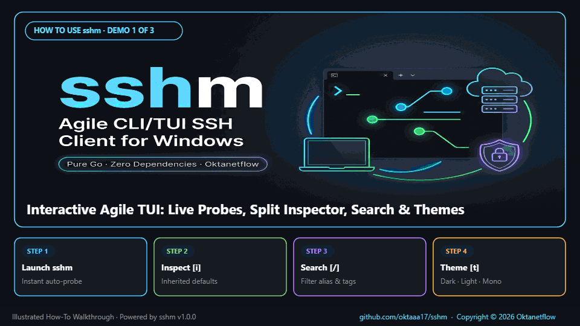
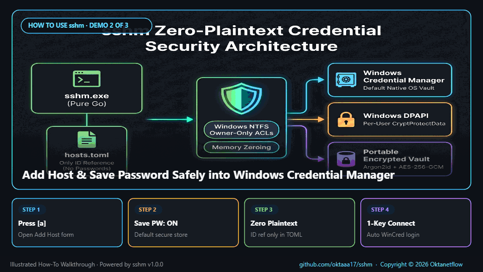
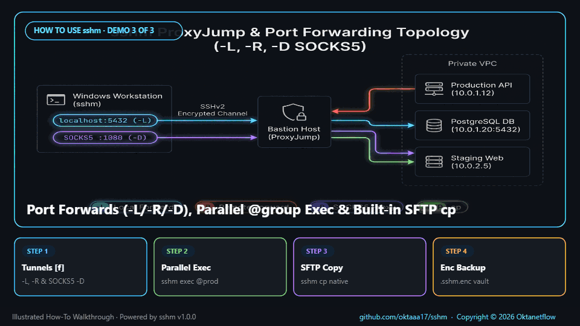

# Illustrated How-To Demo Videos — sshm by Oktanetflow

> **Publisher:** Oktanetflow · **Copyright © 2026 Oktanetflow**  
> **Formats Included:** Inline-playable Animated `.gif` (GitHub Markdown native) + `.webm` (VP8 video clips)  
> **Reproducible Renderer:** `node docs/scripts/render-media.mjs` (zero `ffmpeg`/`vhs` installs required)

Each demo video below is an **illustrated, step-by-step how-to walkthrough** combining architectural visuals, numbered step progress bars, keystroke callouts, and live `sshm` TUI / PowerShell sessions.

---

## Demo 1: Agile TUI Navigation, Inspector, Search, Probes & Themes

**What you'll learn:**
1. Launch `sshm` with non-blocking async TCP latency probing (`● 14ms` / `● off`)
2. Inspect effective inherited defaults in the **Split-Pane Host Inspector** (`i`)
3. Filter across alias, IP, tags, and notes with instant **Fuzzy Search** (`/`)
4. Cycle `minimal-dark` → `minimal-light` → `mono` live (`t`)
5. Press `Enter` to open a native Win32 VT100 SSH session via `ProxyJump`



- **Video Clip (WebM):** [`docs/assets/videos/demo-tui-agile-workflow.webm`](assets/videos/demo-tui-agile-workflow.webm)
- **Related Docs:** [MOCKUPS.md](MOCKUPS.md) · [USAGE.md](USAGE.md) · [ADR-004](decisions/ADR-004-bubble-tea-split-pane-tui-and-async-probing.md)

---

## Demo 2: Add Host & Zero-Plaintext Save-Password-by-Default

**What you'll learn:**
1. Press `a` to open the **Add Host** modal with `Save Password: [x] Yes` enabled by default
2. Enter alias, host, group, tags, notes, and masked password
3. Visualize the **Zero-Plaintext Split Save**: `hosts.toml` stores only `credential_ref = "sshm:<id>"` (protected by Windows NTFS owner-only ACLs) while the secret flows straight into **Windows Credential Manager (`CredWriteW`)** with RAM zeroing
4. Reconnect with a single keystroke or switch backends (`wincred` / `dpapi` / `vault`) via CLI



- **Video Clip (WebM):** [`docs/assets/videos/demo-add-host-wincred-connect.webm`](assets/videos/demo-add-host-wincred-connect.webm)
- **Related Docs:** [SECURITY.md](../SECURITY.md) · [GUIDELINES.md](GUIDELINES.md) · [ADR-002](decisions/ADR-002-save-password-by-default-and-credstore.md)

---

## Demo 3: Port Forwards, Parallel `@group` Batch Exec & SFTP `cp`

**What you'll learn:**
1. Open the interactive **Port Forwards** modal (`f`) to save persistent `-L` local, `-R` remote, and `-D` SOCKS5 tunnels (paired with the ProxyJump network topology illustration)
2. Execute concurrent commands across an entire group with `sshm exec @prod "..." --parallel`
3. Upload & download artifacts natively via pure-Go SFTP (`sshm cp`) with zero external `scp.exe`
4. Import PuTTY Registry / `~/.ssh/config` hosts and export Argon2id + AES-256-GCM encrypted `.sshm.enc` backups



- **Video Clip (WebM):** [`docs/assets/videos/demo-tunnels-batch-sftp.webm`](assets/videos/demo-tunnels-batch-sftp.webm)
- **Related Docs:** [USE_CASES.md](USE_CASES.md) · [ADR-001](decisions/ADR-001-pure-go-ssh-engine.md) · [ADR-005](decisions/ADR-005-toml-config-group-inheritance-and-atomic-writes.md)

---

## Regenerating All Videos & Mockups Locally

All 6 mockups and 3 illustrated videos are generated deterministically from source illustrations and `styles.go` colors:

```powershell
node docs/scripts/render-media.mjs
powershell -ExecutionPolicy Bypass -File docs/scripts/verify-docs.ps1
```
