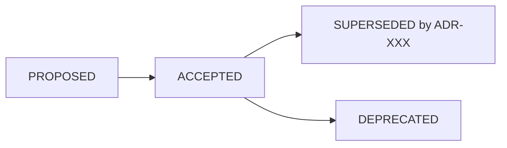

# Architecture Decision Records (ADRs) — sshm by Oktanetflow

> **Copyright © 2026 Oktanetflow**

This directory stores the Architecture Decision Records (ADRs) for **`sshm`**. Code shows *what* was built; these ADRs capture *why* it was built this way, what constraints applied (especially on Windows 10/11), and which alternatives were evaluated and rejected.

---

## ADR Index

| ID | Title | Status | Date |
| :--- | :--- | :--- | :--- |
| [ADR-001](ADR-001-pure-go-ssh-engine.md) | Pure-Go Embedded SSHv2 & SFTP Engine (Zero External Binaries) | Accepted | 2026-11-26 |
| [ADR-002](ADR-002-save-password-by-default-and-credstore.md) | Save-Password-by-Default with Three-Tier Credential Store | Accepted | 2026-11-26 |
| [ADR-003](ADR-003-windows-first-vt100-ntfs-acl-and-pe-packaging.md) | Native Win32 VT100 PTY, NTFS Owner-Only ACLs & Non-Packed PE Packaging | Accepted | 2026-11-26 |
| [ADR-004](ADR-004-bubble-tea-split-pane-tui-and-async-probing.md) | Bubble Tea Split-Pane Agile TUI & Bounded Async TCP Probing | Accepted | 2026-11-26 |
| [ADR-005](ADR-005-toml-config-group-inheritance-and-atomic-writes.md) | TOML Configuration, Group Default Inheritance & Mutex-Safe Atomic Persistence | Accepted | 2026-11-26 |
| [ADR-006](ADR-006-independent-codebase-and-distribution.md) | Independent Codebase & Per-User Windows Inno Setup Distribution | Accepted | 2026-11-26 |

---

## ADR Lifecycle & Rules

1. **Never delete old ADRs.** Historical decisions explain *why* past constraints existed so future contributors and AI agents do not re-introduce solved problems.
2. **Supersede rather than rewrite.** When a major decision changes, author a new numbered ADR (`ADR-007-...`) and update the old ADR's `Status` to `Superseded by ADR-007`.
3. **Sequential numbering.** Name new files `ADR-NNN-short-kebab-title.md` and register them in the index table above.
4. **Required sections.** Every ADR must contain: `Status`, `Date`, `Context`, `Decision`, `Alternatives Considered`, and `Consequences`.
